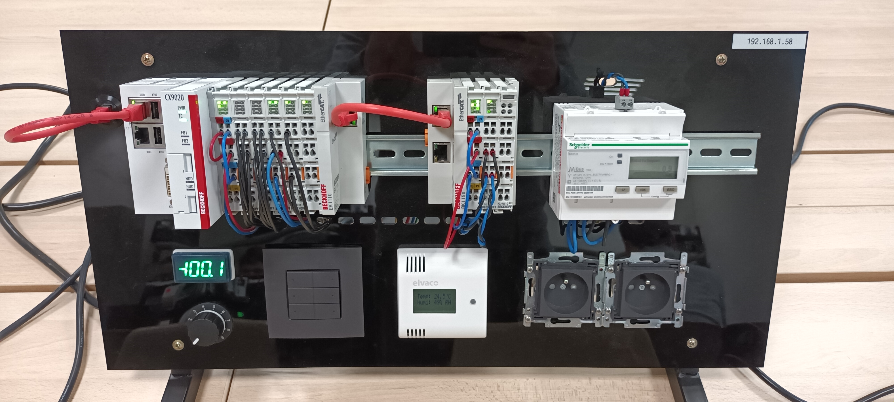

## The setup

MBus (Meter-Bus) is a communication protocol used for remote reading of gas, water, electricity, and heat meters. It is a standardized protocol for transmitting consumption data from the meter to a central data collection point, typically located at the utility company.

The MBus protocol operates on a two-wire serial bus, with a maximum cable length of up to 2 kilometers. The protocol defines the data format, baud rate, and message protocol for communication between the meter and the data collection system. MBus also supports different types of meters, such as single-jet, multi-jet, and turbine meters.

The data link layer of MBus uses a packet-based protocol that consists of a header, data field, and checksum. The header contains information about the packet, such as the address of the meter and the type of data being transmitted. MBus is designed to provide a reliable and efficient data transmission rate for metering applications, rather than high transfer-speed.

> Beckhoff Application Film: [LIMTEC+, Belgium: Media technology and building automation on one platform](https://www.youtube.com/watch?v=ULxKM4GE4ZU&list=PLO_MYxzSFFnYWlXqCy7Ek5_9-lSvw86cJ&index=12)

## Hardware

- Mbus devices:
  - Elvaco CMa10 temperature and humidity sensor
  - Schneider Electric iEM3135 energie meter
  
- PLC terminal: 
  - KL6781 Mbus master terminal

## Preperations

- Lees de [documentatie van de Mbus temperature and humidity sensor](https://www.elvaco.com/en/product/sensors/cma10-indoor-temperaturehumidity-sensor-m-bus--1050131)

- Lees de [documentatie van de Mbus energie meter](https://www.se.com/ww/en/product/A9MEM3135/iem3135-energy-meter-63-a-mbus-1-digital-i-1-digital-o-multitariff-mid/)

- Raadpleeg de handleiding van de Beckhoff [KL6781 Mbus Master](https://download.beckhoff.com/download/document/io/bus-terminals/kl6781en.pdf). Lees zeker de pagina's:
    - Product overview => Introduction
    - Product overview => Technical data 
    - Mounting and wiring => connection assignment
    - Access from the user program => Process image
    
- Lees volgende pagina's over de Mbus bibliotheek [TC2_MBUS](https://infosys.beckhoff.com/english.php?content=../content/1033/tcplclib_tc2_mbus/index.html&id=)
    - Introduction
    - M-Bus
    - M-Bus => Bulletin
    - Programming => POUs => FB_MBUSKL6781
    - Programming => POUs => General device blocks, elvaco en Schneider Electric
    - Programming => DUTs => Structures => ST_KL6781inData22B, ST_KL6781outData22B en ST_MBUS_Communication

## Goals

1.  Leg in je eigen woorden Mbus uit. Hoe is het opgebouwd en wat kan je ermee?
2.  Beschrijf de aansluitingen van de KL6781.
3.  Beschrijf de 'FB_MBUSKL6781' functieblok. Welke zijn de in- en uitgangen en waarvoor wordt deze gebruikt?
4.  Beschrijf de 'ST_KL6781outData22B' structure. Wat is de inhoud en waarvoor wordt deze gebruikt?
5.  Beschrijf de 'ST_KL6781inData22B' structure. Wat is de inhoud en waarvoor wordt deze gebruikt?
6.  Beschrijf de 'ST_MBUS_Communication' structure. Wat is de inhoud en waarvoor wordt deze gebruikt?
7.  Beschrijf de aansluitingen en de werking van de Mbus temperature and humidity sensor.
8.  Beschrijf de aansluitingen en de werking van de Mbus energie meter.

## Exercises

Programmeer de PLC zodat alle toestellen op het M-bus netwerk en hun data zichtbaar zijn vanuit een visualisatie. Voor M-bus te programmeren dien je de bibliotheek Tc2_MBUS toe te voegen bij je References.

### Programmatie (minimaal vereist om 60% te behalen)

#### 1. Communicatie en device scanning (10%)

Maak gebruik van de 'FB_MBUSKL6781' functieblok voor de communicatie met de KL6781. Koppel de juiste variabelen met de KL6781. **Voer een scan uit** om alle devices op het M-bus netwerk te detecteren en achterhaal de fabrikant van elk device. Zorg dat scan en resultaten vanuit de visualisatie zichtbaar zijn.

#### 2. Temperatuur en vochtigheid sensor uitlezen (10%)

Lees alle mogelijke data-waarden van de Mbus temperature en vochtigheidssensor uit. Toon alle waarden in de visualisatie.

#### 3. Energie meter uitlezen (15%)

Lees de energie meter uit met de **general blocks**. Je zal hiervoor de registers moeten raadplegen in de documentatie van de meter. Toon alle relevante waarden in de visualisatie (spanning, stroom, vermogen, energie, etc.).

#### 4. Temperatuur en vochtigheid sensor uitlezen met general blocks (15%)

Lees de temp/hum sensor uit met de **general blocks** (NIET de kant-en-klare Elvaco FB). Je zal hiervoor de registers moeten raadplegen in de documentatie van de sensor. Toon alle waarden in de visualisatie.

**Belangrijk:** Je moet de low-level general device blocks gebruiken en zelf de juiste registers opzoeken. Dit leert je hoe M-Bus communicatie op laag niveau werkt.

#### 5. Alarm-systeem (10%)

Implementeer een alarm-systeem dat triggert wanneer:
- Temperatuur < 18°C of > 26°C (drempelwaarden instelbaar via visualisatie)
- Vochtigheid < 30% of > 70% (drempelwaarden instelbaar via visualisatie)
- Vermogen > instelbare drempelwaarde (W)

Bij elk alarm moet:
- Een specifieke LED op de EL2008 gaan branden (bv. LED 1 voor temp, LED 2 voor vocht, LED 3 voor vermogen)
- Een teller bijhouden hoeveel keer elk alarm type is afgegaan
- De tellers en alarm-status zichtbaar zijn in de visualisatie
- Elk alarm heeft een bijhorende reset-knop in de visualisatie.

---

### Bijkomende programmatie (Percentage telt enkel indien minimale programmatie bereikt is)

#### 6. CSV data logging (20%)

Schrijf alle sensor-data weg naar een CSV file met de volgende functionaliteit:
- Header met kolomnamen (Timestamp, Temperatuur, Vochtigheid, Spanning, Stroom, Vermogen, Energie, etc.)
- Timestamp per regel in formaat: `YYYY-MM-DD HH:MM:SS`
- Sample rate instelbaar via visualisatie (1s - 60s)
- Bestandsnaam instelbaar via visualisatie (met .csv extensie)
- Start/Stop logging via druktoets in visualisatie
- Toon aantal regels geschreven in visualisatie
- Toon huidige logging status (actief/gestopt)

#### 7. Energie-monitoring dashboard (20%)

Implementeer een geavanceerd energie-monitoring dashboard in de visualisatie met:

**Grafieken:**

- Grafiek van vermogen over tijd (laatste 10 minuten, update elke 10 seconden)
- Grafiek van temperatuur over tijd (laatste 10 minuten, update elke 10 seconden)

**Statistieken:**

- Peak detector: toon het maximale vermogen van de huidige sessie + timestamp wanneer dit gemeten werd
- Totaal verbruik sinds start (kWh) met reset-functie via druktoets
- Gemiddeld verbruik per minuut over de laatste 10 minuten

## Questions

For questions and support please place a comment in the pull request titled **Feedback**.

## Remarks

Take care of the setup. Afterwards return the setup to its original state and place it on top of the lab table in the same place. If you notice a defect, you must immediately inform the teacher.
